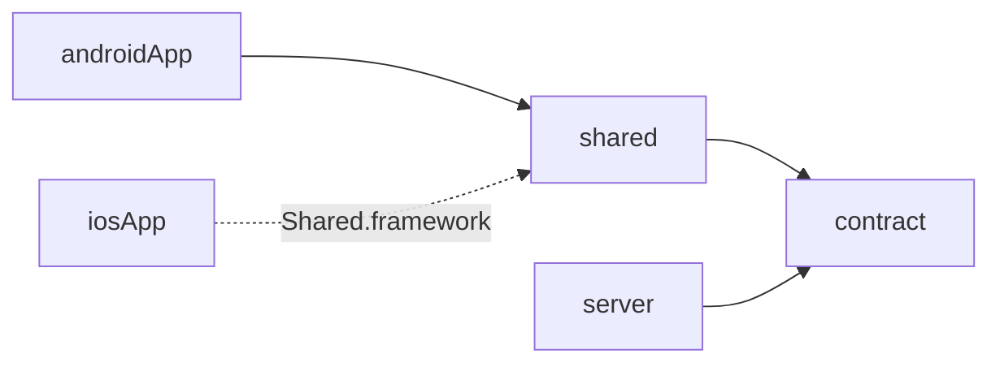

# 1. Project structure

## Modules

```
kmpMyToDo/
├── contract/     KMP (JVM, Android, iOS)  API DTOs + routes, shared with the server
├── shared/       KMP (Android, iOS)       everything except UI
├── server/       Kotlin/JVM (Ktor)        placeholder backend
├── androidApp/   Android                  Compose UI only
└── iosApp/       Xcode project            SwiftUI UI only
```



**Why `contract` is its own module:** the server is a JVM app and must not pull
in Room, ViewModels or Android code. Putting only the DTOs and route paths in
a tiny module with JVM, Android and iOS targets lets the server and both apps
compile against *the same* wire format. Rename a field and both sides fail to
compile, instead of failing at runtime.

**Why the Android app is a separate module:** with AGP 9, a KMP library uses
the `com.android.kotlin.multiplatform.library` plugin and can't also be the
application. Keeping `androidApp` thin mirrors `iosApp` and keeps the shared
module a plain library.

## What goes where

| Lives in `shared` | Lives in the app |
|---|---|
| Models, validation, sorting, filtering, display text | Screens and navigation |
| Room database, DAO, migrations | Theme, colours, icons |
| Ktor client, API, sync engine | Platform UI behaviour (snackbars, swipe actions) |
| ViewModel and UI state | Creating the container with platform inputs |
| DI container | Platform config (base URL, build type) |

Rule of thumb: **if both apps would implement it the same way, share it.**
Even user-visible strings like "3 items left" or "Offline · 1 change not
synced" are produced in [`TodoRules`](../shared/src/commonMain/kotlin/com/andy/mytodo/domain/TodoRules.kt),
so wording and pluralisation can't drift between platforms.

## Packages inside `shared`

```
com.andy.mytodo
├── model/          Todo, Priority, TodoFilter — plain data the UI shows
├── domain/         TodoRules, TodoRepository, SyncController — interfaces + pure logic
├── data/           implementations
│   ├── local/      Room entity, DAO, database, migrations
│   ├── remote/     Ktor client factory, TodoApi
│   ├── sync/       SyncManager
│   └── Mappers.kt, OfflineFirstTodoRepository.kt
├── presentation/   TodoListViewModel, TodoListUiState
└── di/             AppContainer, AppConfig
```

### The dependency rule

`presentation → domain ← data`. The domain layer defines interfaces
(`TodoRepository`, `SyncController`) and `data` implements them. `domain`
never imports from `data`:

```bash
grep -rn "mytodo.data" shared/src/commonMain/kotlin/com/andy/mytodo/domain   # must print nothing
```

This is why the ViewModel can be tested with fakes and never touches Ktor or
Room ([chapter 9](09-testing.md)).

## Source sets

| Source set | Contains |
|---|---|
| `commonMain` | Almost everything |
| `androidMain` | [`createAppContainer(context, config)`](../shared/src/androidMain/kotlin/com/andy/mytodo/AndroidAppContainer.kt): DB path from `Context`, OkHttp engine |
| `iosMain` | [`SharedApp` and `TodoListViewModelOwner`](../shared/src/iosMain/kotlin/com/andy/mytodo/IosApp.kt): DB path, Darwin engine, Swift-facing helpers |
| `commonTest` | Tests run on **both** JVM and iOS |
| `iosTest` | Tests that need iOS APIs (the migration test) |

Prefer passing platform things in as parameters (a path, an engine) over
`expect`/`actual`. The only `expect` here is Room's generated database
constructor, which Room requires.
