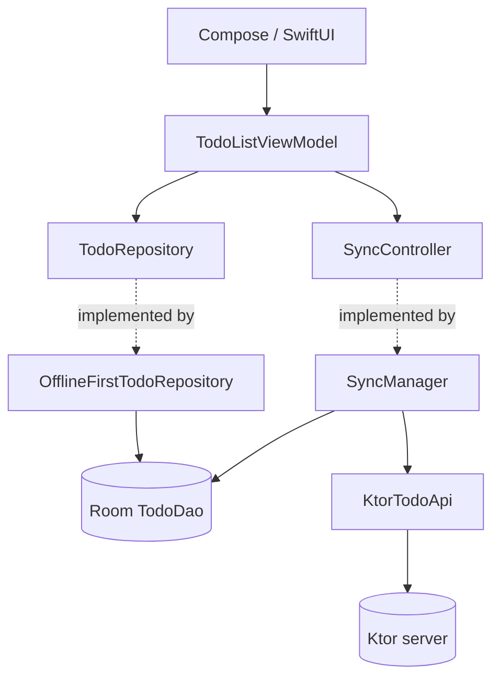

# 3. Architecture



## One type per layer

| Type | Layer | Shaped by |
|---|---|---|
| [`TodoEntity`](../shared/src/commonMain/kotlin/com/andy/mytodo/data/local/TodoEntity.kt) | database | SQL needs (priority as `Int`, `syncState`) |
| [`TodoDto`](../contract/src/commonMain/kotlin/com/andy/mytodo/contract/TodoContract.kt) | network | the API (priority as `"high"`, defaults for evolution) |
| [`Todo`](../shared/src/commonMain/kotlin/com/andy/mytodo/model/Todo.kt) | UI and domain | what screens need (`isPendingSync: Boolean`) |

All conversions are in [`Mappers.kt`](../shared/src/commonMain/kotlin/com/andy/mytodo/data/Mappers.kt).
It feels like extra work for a small app, but it pays off quickly. Adding
`syncState` to the database didn't touch the API, and the UI got a simple
`isPendingSync` flag instead of a database enum.

## Repository: one way to change data

[`OfflineFirstTodoRepository`](../shared/src/commonMain/kotlin/com/andy/mytodo/data/OfflineFirstTodoRepository.kt)
is the only code that writes to-dos. Every write:

1. Goes straight to the local database (it never waits for the network).
2. Marks the row `Dirty`, or `Deleted` as a tombstone.
3. Gets its ID from `Uuid.random()` and its time from an injected clock.

The clock and ID generator are constructor parameters with defaults, so tests
get deterministic values without any mocking library.

## Dependency injection: a hand-written container

[`AppContainer`](../shared/src/commonMain/kotlin/com/andy/mytodo/di/AppContainer.kt)
builds the whole object graph in about 30 lines. Each platform creates exactly
one and passes in only what's platform specific:

```kotlin
AppContainer(
    database = buildTodoDatabase(platformBuilder), // file path differs per platform
    httpEngine = OkHttp.create(),                  // or Darwin.create()
    config = AppConfig(apiBaseUrl = …),
)
```

**Why not Koin?** For one screen, a constructor-based container is easier to
read, fails at compile time rather than at runtime, and adds no library. Switch
to Koin (or kotlin-inject) once you have many screens and feature modules and
the container becomes a maintenance burden. The rest of the code won't care,
because everything already receives its dependencies through constructors.

## Coroutine scopes

| Scope | Owner | Used for |
|---|---|---|
| `viewModelScope` | ViewModel | UI-triggered work (save an edit, toggle) |
| `appScope` (in `AppContainer`) | process | sync, so leaving a screen never cancels a half-done sync |

[`SyncManager.sync()`](../shared/src/commonMain/kotlin/com/andy/mytodo/data/sync/SyncManager.kt)
runs its work in `appScope` and lets the caller wait for the result:

```kotlin
override suspend fun sync(): Boolean = scope.async { syncOnce() }.await()
```

If the caller is cancelled (the user leaves pull-to-refresh), only the
*waiting* stops; the sync itself completes.

## Config

`AppConfig` (in [`AppContainer.kt`](../shared/src/commonMain/kotlin/com/andy/mytodo/di/AppContainer.kt))
holds values that differ per build. Each platform fills it from its native
mechanism:

- **Android:** `BuildConfig.API_BASE_URL`, set per build type in Gradle.
- **iOS:** the `API_BASE_URL` build setting → Info.plist → read by `SharedApp`.
