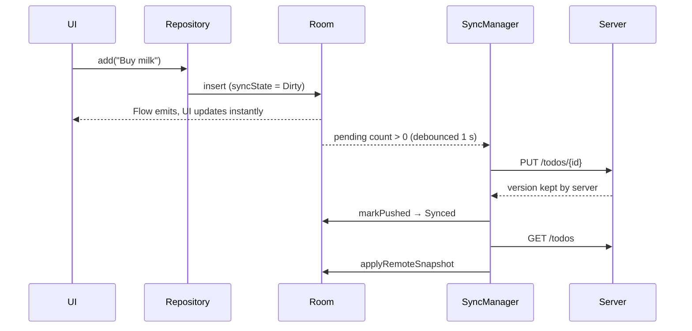

# 6. Offline-first sync

## The core idea

**The UI only ever reads the local database.** Writes go to the database
immediately and are flagged. A background sync engine reconciles with the
server whenever it can. The app is fully usable offline, and the network
never blocks the UI.

## Design decisions

### Client-generated UUIDs
IDs are created on the device (`Uuid.random()`), so an item has its permanent
ID from the moment it exists. There's no "temporary local ID → server ID"
mapping, and `PUT /todos/{id}` can be an idempotent upsert.

### A sync state per row
[`SyncState`](../shared/src/commonMain/kotlin/com/andy/mytodo/data/local/TodoEntity.kt):

| State | Meaning |
|---|---|
| `Synced` | matches the server |
| `Dirty` | created or edited locally; needs `PUT` |
| `Deleted` | **tombstone**: hidden from the UI, needs `DELETE`, then purged |

**Why tombstones:** if a delete removed the row immediately, sync would have
no record that the server needs a `DELETE`. Keeping the row until the server
confirms makes deletes work offline and makes undo trivial: undo just flips
the row back to `Dirty`.

### Push, then pull
[`SyncManager.syncOnce()`](../shared/src/commonMain/kotlin/com/andy/mytodo/data/sync/SyncManager.kt)
pushes all pending rows first, then fetches the server's list. Pulling first
could overwrite local changes before they were sent.

### Merging the pull ([`applyRemoteSnapshot`](../shared/src/commonMain/kotlin/com/andy/mytodo/data/local/TodoDao.kt))
In one transaction:
- A server row **replaces** the local row only if the local row is `Synced`
  (or doesn't exist). Unpushed local edits are never overwritten.
- A local `Synced` row that is **missing from the server** was deleted on
  another device, so it's removed.

### Conflicts: last write wins
Each edit sets `updatedAt`. The server keeps whichever version is newer and
returns it from `PUT`. The client then stores whatever the server returned, so
if another device's later edit won, this device adopts it.

**Limitation:** `updatedAt` comes from device clocks, and a device whose clock
is far ahead will always win. Production systems usually use a server-assigned
version number instead (see [Roadmap](11-roadmap.md)).

### Edits made while a push is in flight
The user can edit an item while its `PUT` is still on the wire.
[`markPushed`](../shared/src/commonMain/kotlin/com/andy/mytodo/data/local/TodoDao.kt)
marks the row `Synced` **only if `updatedAt` hasn't changed since the row was
sent**; otherwise it stays `Dirty` and goes up on the next sync. The same
check stops `purgeTombstone` from deleting an item that was restored by undo
in the meantime. Both cases have a test.

## Triggers

| Trigger | Where |
|---|---|
| App start | `SyncManager.start()` |
| Any local change (debounced 1 s, so typing quickly sends one batch) | `observePendingCount().filter { it > 0 }.debounce(…)` |
| Pull-to-refresh | `TodoListViewModel.refresh()` (a suspend function) |
| After a failure | backoff retry: 5 s, 10 s, 20 s … capped at 5 min |

A `Mutex` makes overlapping triggers run one after another, never at the same
time.

## Status shown to the user

The sync state is reduced to one line in shared code
([`TodoRules.syncLabel`](../shared/src/commonMain/kotlin/com/andy/mytodo/domain/TodoRules.kt)):
"Synced", "Syncing…", "Offline · 2 changes not synced", "Sync failed, will
retry". Rows with unsynced changes show a small sync icon. Users should always
be able to tell whether their data is safe.

## A hazard to know about: server data loss spreads

Because "missing from the server" means "deleted elsewhere", **a server that
loses its data makes every client delete its synced items** on the next sync.
This was found while testing this app: the placeholder server first kept data
in memory, and restarting it would have wiped every device. The fix is the
same as for any real backend: the server must be durable. Here, the
[`TodoStore`](../server/src/main/kotlin/com/andy/mytodo/server/TodoStore.kt)
saves to `server/build/data/todos.json`.

For extra safety in production, use **delta sync** (the server returns changes
and explicit tombstones since a cursor) instead of comparing full snapshots.
Then a server returning an empty list doesn't look like "everything was
deleted".

## Verified behaviour

Unit tests ([`SyncManagerTest`](../shared/src/commonTest/kotlin/com/andy/mytodo/data/SyncManagerTest.kt))
cover push, pull, remote deletes, local deletes, offline, server errors,
last-write-wins, edits during an in-flight push, and undo after a synced
delete. They run on both the JVM and iOS.

End to end against the real server:

| Scenario | Result |
|---|---|
| v1 → v2 upgrade with existing data (iOS) | rows migrated and uploaded |
| Add on Android | arrives on iOS as Synced |
| Add while the server is down | saved locally, status "Offline · 1 change not synced" |
| Server comes back | the backoff retry synced it within 18 s, with no user action |
| Delete on Android | removed on iOS |
